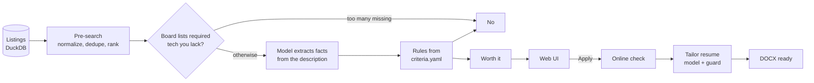

# jobby

Local-first job triage. Jobby reads thousands of job listings, decides which
ones are worth your time, and prepares a tailored copy of your resume for the
ones you choose to apply to. The language model runs on your own machine
through [Ollama](https://ollama.com), so your resume is never sent to a cloud
API.

Listings come from
[job-market-analysis](https://github.com/NikitaKorDev/job-market-analysis),
a set of scrapers for Polish job boards (justjoin.it, No Fluff Jobs,
Bulldogjob, pracuj.pl, praca.pl, OLX). Jobby only reads that data. It does no
scraping of its own.

## Principles

- **Local by default.** Inference runs on Ollama, state lives in SQLite, and
  the only outbound requests are short checks that a listing is still online.
- **The model extracts, the rules decide.** The model reads a listing and
  reports facts: work mode, required years, languages, seniority,
  technologies. Plain Python then applies your criteria, so every rejection
  names the rule behind it, and changing a rule never needs the model again.
- **Tailoring can't invent.** The model can reorder, rephrase and emphasize
  what your resume already says. A separate check rejects any edit that adds
  a technology, employer, number or date your resume doesn't contain.
- **Careful where mistakes are costly.** A listing is dropped only on strong
  evidence; when something is unclear, the listing stays in. Jobby never
  guesses that an offer has expired, because a false "expired" deletes it.
- **Your original resume is read-only.** Every tailored version is a new file.

## How it works



1. **Pre-search** (`jobby/search/`). Each current listing is normalized: tags
   split and aliased, seniority taken from the board field or title, work mode
   and years of experience read from the description. Listings are scored and
   ranked. The same job posted on several boards or for several cities is
   evaluated once.
2. **Rules before the model.** When a board lists required technologies and
   more of them are missing from your skills than `max_missing_required`
   allows, the listing is a "no" without a model call.
3. **Extraction** (`jobby/determinator/extract.py`). The model reads the
   description and returns structured JSON, checked against a schema. It
   reports facts and doesn't judge.
4. **Decision** (`jobby/determinator/decide.py`). Python applies
   `config/criteria.yaml`. The result is a yes or no, the reasons, and a fit
   score used for ranking (it isn't a probability).
5. **Review and apply.** In the web UI you go through the "worth it"
   listings. **Apply** first checks the offer is still online, then queues a
   tailored resume.
6. **Tailoring** (`jobby/tailor/`). A background worker copies your DOCX, asks
   the model for a plan of edits, drops every edit the guard rejects, and
   applies the rest with the original formatting kept.

The batch can be stopped at any time with Ctrl+C. Everything evaluated so far
is saved, and the next run continues where it left off.

## Web UI

A small Vite + React app served by the FastAPI backend at
`http://127.0.0.1:8000`.

| Page | What it does |
|---|---|
| **Processed** | Listings judged worth applying to, best fit first. Apply or reject each one. |
| **Tailored** | The resume queue. Download finished DOCX files, retry failures, mark a listing as applied. |
| **Applications** | Listings you applied to, with an outcome per listing (no response, rejected, accepted). |

See [`web/README.md`](web/README.md) for frontend development, including a
dependency-free mock API.

## Requirements

- Python 3.14 (the version Jobby is developed and tested on)
- [Ollama](https://ollama.com), with the models named in `config/jobby.yaml`
  pulled (by default `qwen3.5:2b` for evaluation and `qwen3:4b` for tailoring)
- Node.js 22, only to build the web UI
- Your resume as a `.docx` file
- A listings database from job-market-analysis, or the bundled demo database

Jobby runs on CPU-only hardware. Expect tens of seconds per evaluated listing
and a minute or two per tailored resume.

## Setup

```bash
git clone https://github.com/NikitaKorDev/jobby.git
cd jobby
python -m venv .venv
source .venv/bin/activate
pip install -r requirements.txt

cd web && npm ci && npm run build && cd ..
```

Put your resume at `resume/resume.docx`, or set `resume.source_path` in
`config/jobby.yaml` to its location.

### Listings source

By default Jobby reads the job-market-analysis database one level up:

```yaml
source:
  mode: duckdb                  # or "fixture" for the demo database
  path: ../job_listings.duckdb  # relative to this folder
  table: dim_job_listings
```

To try Jobby without the scrapers, set `mode: fixture`. That uses
`fixtures/sample.duckdb`, which holds 12 real listings from four boards.
`python fixtures/build_fixture.py` rebuilds it.

### Ollama

`ollama.url: auto` tries `OLLAMA_URL` (or `OLLAMA_HOST`), then `localhost`,
then the WSL default gateway. That last one finds Ollama running on the
Windows side of a WSL setup without extra configuration. Set an explicit URL
to skip the search.

## Usage

```bash
python main.py              # evaluate new listings, then open the web UI
python main.py --ui-only    # open the web UI only
python main.py --limit 50   # evaluate at most 50 listings, then open the UI
```

The `python -m jobby` command gives finer control:

| Command | Purpose |
|---|---|
| `run [--limit N] [--dry-run] [--redecide] [--model M]` | Rank and evaluate listings. `--dry-run` only reports what would be evaluated. `--redecide` re-applies the criteria to stored results without the model. |
| `serve` | Start the web UI and API. |
| `search [--top N]` | Show the pre-search summary and the top-ranked listings. |
| `tags [--refresh]` | Show the technologies Jobby thinks you know. `--refresh` re-extracts them from the resume and overwrites your edits. |
| `label [--count N] [--seed S]` | Label real listings yes or no, for benchmarking. |
| `bench [--models A B ...]` | Compare models against your labels. |

Every command takes `--config PATH` to use a different `jobby.yaml`.

## Configuration

Everything that can be tuned is in `config/`. Nothing is hard-coded.

| File | Contents |
|---|---|
| `jobby.yaml` | Data source, models, context window, batch size, search thresholds, API host and port, paths. |
| `criteria.yaml` | Your rules: allowed work modes, languages, seniority levels, maximum years of experience, how many required technologies may be missing. |
| `tag_aliases.yaml` | Maps technology name variants to one name (`js` → `javascript`), plus terms that never count as a skill match. |
| `resume_tags.yaml` | Technologies you know. Extracted from your resume on the first run, then edited by hand. Gitignored. |

Edit `criteria.yaml`, then run `python -m jobby run --redecide`: every stored
result is re-judged in seconds, without the model. When you add a technology
to `resume_tags.yaml`, the next run re-decides only the listings that were
rejected because it was missing.

## Choosing a model

Small models vary a lot on this task, so Jobby includes a way to measure them
on your own data:

```bash
python -m jobby label --count 30                  # label 30 real listings yes/no
python -m jobby bench --models qwen3.5:2b qwen3:4b
```

For each model, the benchmark reports agreement with your labels, the
listings it got wrong and why, and seconds per listing. It also checks that
the pre-search never excludes, merges away or buries a listing you labeled
"yes". Results go to `bench/<timestamp>/report.md` (gitignored, since they
contain verdicts about your resume).

## Privacy

Your personal data stays on your machine and out of git:

| Path | Contents |
|---|---|
| `resume/` | Your source resume |
| `resumes/` | Generated tailored resumes |
| `data/` | Jobby's SQLite database: results, queue, applications |
| `bench/` | Benchmark reports |
| `config/resume_tags.yaml`, `config/labels.yaml` | Your skills and labels |

## Project layout

```
jobby/
├── main.py              batch, then web UI
├── config/              all settings and rules
├── jobby/
│   ├── search/          normalization, deduplication, ranking
│   ├── determinator/    extraction, rules, batch runner, resume tags
│   ├── tailor/          DOCX editing, guard, background worker
│   ├── api/             FastAPI backend
│   ├── data/            DuckDB reader, SQLite store
│   ├── online.py        "is this offer still up?" per board
│   ├── bench.py         labeling and model benchmark
│   └── ollama_client.py
├── web/                 Vite + React + TypeScript UI
├── fixtures/            demo listings database and its builder
└── tests/
```

## Development

```bash
pytest                  # backend tests, no Ollama needed
cd web && npm run mock  # full API with sample data, no Python needed
```

The tests replace the model with stubs and build their own resume and
listings, so they run offline in a few seconds.
